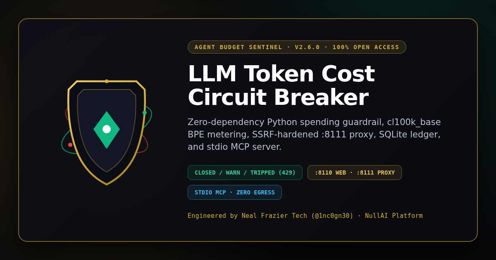

# Agent Budget Sentinel (`v2.6.0`)



**Agent Budget Sentinel** (`agent-budget-sentinel`) is a zero-dependency Python 3.10+ spending guardrail, token-cost circuit breaker, SSRF-hardened inline LLM reverse proxy (`127.0.0.1:8111`), live telemetry cockpit (`127.0.0.1:8110`), and stdio JSON-RPC 2.0 MCP server. It intercepts runaway agent loops and enforces hard USD ceilings and per-minute velocity limits with SQLite persistence (`budget.db`).

- **Zoth Studio v2 Route**: `http://127.0.0.1:3000/tools/agent-budget-sentinel`
- **Repository**: [https://github.com/1nc0gn30/agent-budget-sentinel](https://github.com/1nc0gn30/agent-budget-sentinel)
- **Loopback Endpoints**: Web Cockpit `http://127.0.0.1:8110` · Inline Breaker Proxy `http://127.0.0.1:8111`

---

## What It Does & How It Works

Autonomous tool-calling loops can burn API budgets rapidly during recursive retries. `agent-budget-sentinel` sits inline between agent runtimes and LLM APIs:

- **Deterministic 3-State Circuit Breaker (`CircuitBreaker`)**: Transitions across `CLOSED` (normal operation), `WARN` (80% ceiling reached), and `TRIPPED` (hard ceiling, velocity limit, or manual kill switch engaged — returning **`HTTP 429 Too Many Requests`** across both `GET` and `POST` forwarded calls).
- **Pure-Python `cl100k_base` BPE Tokenizer (`BPETokenizer`)**: Sub-millisecond embedded LZMA vocabulary with zero pip dependencies and mid-flight SSE stream guillotine.
- **2025/2026 & `$0.00` Local Sovereign Pricing (`CostCalculator`)**: Covers OpenAI (`gpt-5`, `gpt-4.1`, `gpt-4o`, `o3`, `o4-mini`, `o1`), Anthropic (`claude-opus-5.5`, `claude-sonnet-5.5`, `claude-opus-4`, `claude-sonnet-4`, `claude-3-5-*`), Google (`gemini-4-neon`, `gemini-3.8-flash`, `gemini-2.5-pro`), DeepSeek (`deepseek-r1`, `deepseek-v3`), and `$0.00` local models (`ollama/*`, `agy/*`, `hermes/*`, `azoth/*`).
- **SSRF & Strict CORS Guard (`net_guard.py`)**: Enforces `http`/`https` schemes only on `X-Target-Url`, blocks loopback/RFC1918/IMDS (`169.254.169.254`)/`file://` with `HTTP 403` (opt-in local upstreams via `AGENT_BUDGET_ALLOW_LOCAL_UPSTREAMS=127.0.0.1:11434`), and rejects spoofed loopback origins (`127.0.0.1:8110.evil.com`) with `HTTP 403`.
- **SQLite Restart Hydration (`BudgetStorage`)**: Persists transactions, ceilings, and events in `budget.db` and hydrates cumulative spend on daemon restart so header telemetry always matches the ledger.

```text
Agent Process (OPENAI_BASE_URL / ANTHROPIC_BASE_URL -> http://127.0.0.1:8111)
        │
        ▼
BudgetProxyServer (:8111) ──► net_guard (SSRF/CORS) ──► CircuitBreaker (CLOSED / WARN / TRIPPED)
        │                                                       │
        ├── Allowed: Forward upstream & stream SSE guillotine   ├── Tripped: Return HTTP 429
        ▼                                                       ▼
BudgetStorage (SQLite) ◄──► BudgetWebServer (:8110) + SSE (/api/stream) + Stdio MCP (`agent-budget mcp`)
```

---

## Quickstart & ZothOS CLI / MCP Commands

```bash
# Start Web Cockpit (:8110) and Inline Breaker Proxy (:8111)
agent-budget serve --host 127.0.0.1 --web-port 8110 --proxy-port 8111 --budget 5.00 --velocity-limit 2.00

# Live telemetry & TUI monitor
agent-budget --status
agent-budget --json
agent-budget-sentinel-tui --status

# Update hard ceiling, emergency trip, and reset
agent-budget set-budget 10.00
agent-budget trip --reason "Halting runaway subagent"
agent-budget reset

# Wrap any agent process with OPENAI_BASE_URL / ANTHROPIC_BASE_URL + ceiling
agent-budget run --max-budget 2.50 -- python3 my_agent.py

# Launch zero-dependency stdio JSON-RPC 2.0 MCP Server
agent-budget mcp --host 127.0.0.1 --port 8110
```

### Exposed MCP Tools (`agent-budget mcp`)
- `budget_circuit_breaker_status`: Inspect live spend/state (`CLOSED | WARN | TRIPPED`) or run `trip` / `reset` / `set-budget`.
- `budget_set_ceiling`: Update hard USD cap and optional velocity cap.
- `budget_trip`: Engage immediate HTTP 429 kill switch.
- `budget_reset`: Restore `CLOSED` state (optionally clearing ledger).
- `budget_estimate_cost`: Local BPE token & USD cost estimator (zero egress).

---

## REST API Reference (`127.0.0.1:8110`)

| Method | Endpoint | Description |
| :--- | :--- | :--- |
| `GET` | `/` | Dual-theme Web Cockpit (supports `?theme=light|dark` and `?embed=1`) |
| `GET` | `/health`, `/api/health` | Service health, `version` (`2.6.0`), ports, and `breaker_state` |
| `GET` | `/api/stats` | Hydrated spend, ceiling, velocity, tokens, model breakdown, and 24h histogram |
| `GET` | `/api/transactions?limit=50` | Recent transactions (`limit` validated `1..500`, `400` on invalid input) |
| `GET` | `/api/pricing` | Cloud & `$0.00` local sovereign model pricing directory |
| `GET` | `/api/stream`, `/api/events` | Real-time Server-Sent Events (SSE) telemetry stream |
| `POST` | `/api/budget` | Update & persist `max_budget_usd` (`> 0` finite) / `velocity_limit` (`>= 0`) |
| `POST` | `/api/trip` | Engage emergency circuit breaker (`{"reason": "..."}`) |
| `POST` | `/api/reset` | Reset breaker to `CLOSED` (`{"reset_spend": false}`) |
| `POST` | `/api/simulate`, `/api/simulate_runaway` | Simulate single call or burst loop without external API spend |

---

## Testing & Verification

```bash
PYTHONPATH=src python3 -m pytest -q tests
agent-budget --help
agent-budget --json
```

---

## Support & License

100% free and open-access under the MIT License (zero paywalls).

- Optional support (Stripe): [Buy Us a Coffee](https://buy.stripe.com/3cIfZg27PdKo2D64Ocfw40X)
- Optional support (Solana): `GG2eQbVh8ut1BK6j1A2tz7pSySdLpD38BgyEhGcxdXoK`
- Engineered by **Neal Frazier Tech** (`@1nc0gn30`) • **NullAI Platform** ([https://nullai.tech](https://nullai.tech))
