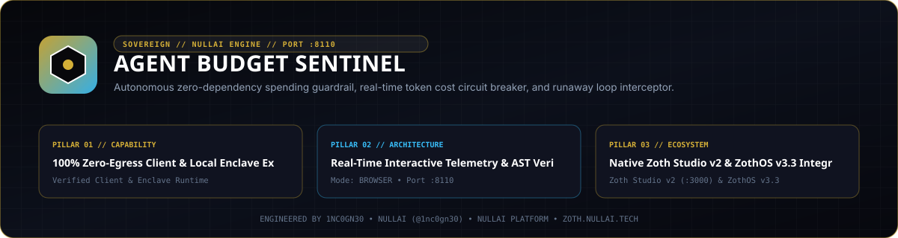

# Agent Budget Sentinel



**Agent Budget Sentinel** (`agent-budget-sentinel`) is a zero-dependency Python 3.10+ spending guardrail, token-cost circuit breaker, inline LLM reverse proxy (`127.0.0.1:8111`), and telemetry web workstation (`127.0.0.1:8110`). It intercepts runaway agent loops and enforces hard USD ceilings and per-minute spend velocity limits with SQLite persistence (`sqlite3`).

- **Zoth Studio v2 Dossier**: [https://zoth.nullai.tech/tools/agent-budget-sentinel](https://zoth.nullai.tech/tools/agent-budget-sentinel)
- **Repository**: [https://github.com/1nc0gn30/agent-budget-sentinel](https://github.com/1nc0gn30/agent-budget-sentinel)
- **Default Loopback Endpoints**: Web Cockpit `http://127.0.0.1:8110` • Inline Breaker Proxy `http://127.0.0.1:8111`

---

## Overview

Autonomous tool-calling loops can exhaust API budgets in minutes when retries or recursive subagents spiral. `agent-budget-sentinel` sits inline between agent runtimes and LLM providers:

- **3-State Circuit Breaker (`CircuitBreaker`)**: Transitions deterministically across `CLOSED` (normal operation), `WARN` (80% ceiling threshold crossed), and `OPEN` (hard ceiling, velocity limit, or manual operator trip engaged — immediately returning `HTTP 429 Too Many Requests`).
- **Per-Model Cost Accounting (`CostCalculator`)**: Computes exact input/output USD spend across OpenAI, Anthropic, Google Gemini, DeepSeek, and local model pricing tables.
- **Velocity Guardrail**: Tracks rolling USD/minute spend rate (`velocity_limit_usd_per_min`) to halt sudden burst loops even before cumulative budget exhaustion.
- **SQLite Ledger (`BudgetStorage`)**: Persists transactions, model breakdowns, hourly spend histograms, and circuit-breaker state transitions in `budget.db` with live Server-Sent Events (`/api/stream`).

---

## Architecture

```text
Agent Process (OPENAI_BASE_URL / ANTHROPIC_BASE_URL -> 127.0.0.1:8111)
        │
        ▼
BudgetProxyServer (:8111) ──► CircuitBreaker (CLOSED / WARN / OPEN)
        │                             │
        ├── Allowed: Forward to Upstream LLM API
        ├── Tripped: Return HTTP 429 immediately
        ▼
BudgetStorage (SQLite) ◄──► BudgetWebServer (:8110) + SSE (/api/stream)
```

---

## Quickstart

```bash
git clone https://github.com/1nc0gn30/agent-budget-sentinel.git
cd agent-budget-sentinel
python3 -m pip install -e .

# Start Web Cockpit (:8110) and Inline Breaker Proxy (:8111)
agent-budget serve --host 127.0.0.1 --web-port 8110 --proxy-port 8111 --budget 5.00 --velocity-limit 2.00
```

Or launch directly from the repository root:

```bash
python3 server.py --web-port 8110 --proxy-port 8111
```

Open `http://127.0.0.1:8110` in your browser.

---

## CLI & ZothOS v3.4.0 Integration

`agent-budget` (`./bin/agent-budget` and `./bin/agent-budget-sentinel-tui`) controls live breaker state and wraps arbitrary agent processes with `OPENAI_BASE_URL` / `ANTHROPIC_BASE_URL` routed through `:8111`:

```bash
# Inspect live circuit-breaker state and USD spend
agent-budget --status
agent-budget --json
agent-budget status --port 8110 --json

# Update hard USD ceiling dynamically
agent-budget set-budget 10.00 --port 8110

# Emergency manual kill-switch trip and reset
agent-budget trip --reason "Halting runaway subagent" --port 8110
agent-budget reset --clear --port 8110

# Run an agent command routed through the inline proxy on :8111
agent-budget run --proxy-port 8111 -- python3 my_agent.py
```

---

## REST API Reference

Mutating `POST` routes enforce local-origin CSRF validation (`127.0.0.1`, `localhost`, `[::1]`, or local CLI callers).

| Method | Endpoint | Description |
| :--- | :--- | :--- |
| `GET` | `/` | Web cockpit (`public/index.html`) |
| `GET` | `/health` | Service health, `web_port` (`8110`), `proxy_port` (`8111`), and `breaker_state` |
| `GET` | `/api/stats` | Current spend, ceiling, velocity, token totals, model breakdown, and 24h histogram |
| `GET` | `/api/transactions?limit=50` | Recent metered or blocked LLM transactions |
| `GET` | `/api/pricing` | Per-model input/output token pricing directory |
| `GET` | `/api/stream`, `/api/events` | Real-time Server-Sent Events (SSE) telemetry stream |
| `POST` | `/api/budget` | Update `max_budget_usd` and/or `velocity_limit` |
| `POST` | `/api/trip` | Engage emergency circuit breaker (`{"reason": "..."}`) |
| `POST` | `/api/reset` | Reset breaker to `CLOSED` (`{"reset_spend": true}`) |
| `POST` | `/api/simulate` | Simulate a metered model request (`{"model": "gpt-4o", "prompt_tokens": 1200, "completion_tokens": 450}`) |
| `POST` | `/api/simulate_runaway` | Simulate a burst loop (`{"model": "o1-preview", "iterations": 15}`) to verify breaker tripping |

---

## Testing & Verification

```bash
PYTHONPATH=src python3 -m pytest -q
./bin/agent-budget --help
./bin/agent-budget --json
```

---

## Support & License

100% free and open-source software under the MIT License.

- Optional support: [Buy Us a Coffee via Stripe](https://buy.stripe.com/3cIfZg27PdKo2D64Ocfw40X)
- Engineered by **1nc0gn30** (`@1nc0gn30`, [https://1nc0gn30.si](https://1nc0gn30.si)) • **NullAI** ([https://nullai.tech](https://nullai.tech))
